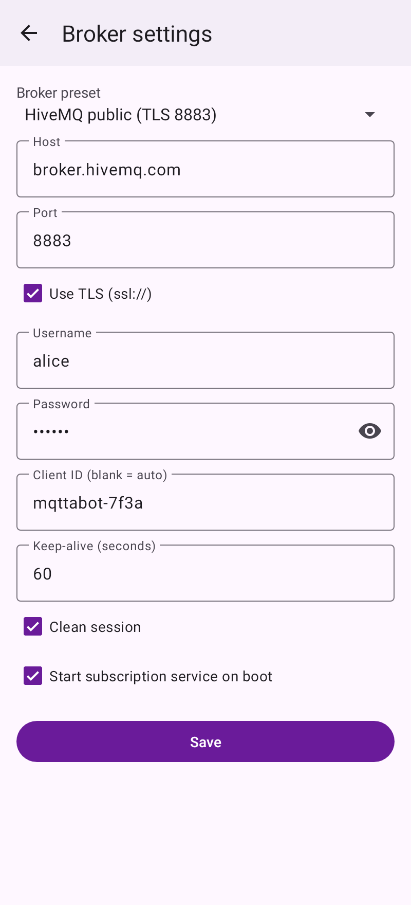
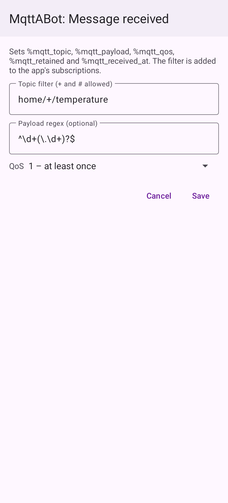

<div align="center">


# MqttABot

[](https://github.com/264768502/mqttabot/actions/workflows/ci.yml)
[](https://github.com/264768502/mqttabot/releases)
[](#build-and-test)
[](LICENSE)
[](https://developer.android.com/about/versions/nougat)
[](https://developer.android.com/about/versions/16)
[](https://kotlinlang.org)
[](https://tasker.joaoapps.com/)
[](https://github.com/264768502/mqttabot/commits/main)

</div>

**English** | [简体中文](README.zh-CN.md)

Android MQTT client + persistent subscription service + Tasker plugin. Written entirely in Kotlin, with no C/C++/JNI code.

- Minimum Android 7.0 (API 24), target Android 16 (API 36), compiled against SDK 37
- MQTT library: Eclipse Paho `mqttv3` (pure Java)
- Build: Gradle 9.8 + AGP 9.5 (built-in Kotlin)

## Screenshots

| Main screen | Broker settings | Tasker event |
| :---: | :---: | :---: |
|  |  |  |

## Features

| Feature | Description |
| --- | --- |
| Publish | Enter topic / payload / QoS / retain on the main screen and send. Reuses the subscription service's long-lived connection when it is running, otherwise opens a one-shot connection. |
| Subscription service | `MqttService` foreground service (`specialUse` type) with an ongoing notification showing the connection state and a "Stop" action; reconnects and resubscribes automatically; optional start on boot. |
| Built-in brokers | test.mosquitto.org (TCP / TLS / authenticated 1884), broker.hivemq.com, broker.emqx.io, mqtt.eclipseprojects.io (TCP and TLS), or a custom broker; supports username, password, client ID, keep-alive and clean session. |
| Tasker action | "MqttABot: Publish" — publish MQTT messages from Tasker; topic and payload accept Tasker `%variables`. |
| Tasker event | "MqttABot: Message received" — received messages trigger Tasker profiles, with topic wildcards (`+`, `#`) and an optional payload regex. Saving the event adds its filter to the subscription list. |
| Languages | English, Simplified Chinese, Traditional Chinese, Spanish, German, Korean and Japanese. The app follows the system language and falls back to English; on Android 13+ it can also be set per app in system settings. |

### Using with Tasker

1. **Publish**: Task → Add Action → Plugin → MqttABot: Publish, then enter a topic (e.g. `home/%room/light`) and payload (e.g. `%state`).
2. **Trigger**: Profile → Event → Plugin → MqttABot: Message received, then enter a topic filter (e.g. `sensors/+/temperature`).
   Make sure the subscription service is running in the app. Variables available when the event fires:

   | Variable | Meaning |
   | --- | --- |
   | `%mqtt_topic` | Message topic |
   | `%mqtt_payload` | Payload (UTF-8) |
   | `%mqtt_qos` | QoS (0–2) |
   | `%mqtt_retained` | Whether it is a retained message (true/false) |
   | `%mqtt_received_at` | Receive time (epoch milliseconds) |

The plugin implements the standard Locale/Tasker plugin protocol (`EDIT_SETTING`/`FIRE_SETTING`, `ACTION_EDIT_EVENT`/`REQUEST_QUERY`/`QUERY_CONDITION`); see `app/src/main/kotlin/com/mqttabot/tasker/`.

## Build and test

Requires JDK 17+ and the Android SDK (`platforms;android-37.0`, `build-tools;37.0.0`); set `sdk.dir` in `local.properties`.

```bash
./gradlew assembleDebug                         # build the APK
./gradlew check                                 # lint (warnings fail) + all tests + 100% coverage gate
./gradlew testDebugUnitTest                     # all JVM tests (unit + end-to-end)
./gradlew jacocoUnitTestCoverageVerification -PskipE2e   # verify 100% coverage with unit tests only
./gradlew testDebugUnitTest --tests 'com.mqttabot.e2e.*'  # end-to-end tests only
./gradlew testDebugUnitTest -Pscreenshots               # re-render screenshots + icon in fastlane/
```

Coverage report: `app/build/reports/jacoco/jacocoUnitTestReport/html/index.html`. The gate requires 100% instruction, branch, line, method and class coverage (only generated `R`/`BuildConfig` are excluded).

### About the tests

- Unit tests use JUnit4 + Robolectric (API 36 by default; `MinSdkCompatTest` runs the main flows on API 24) + MockK.
- End-to-end tests (`app/src/test/kotlin/com/mqttabot/e2e/`) start a real MQTT broker in-process (Moquette, with its native dependencies excluded so it runs on pure Java/NIO). The app uses the real Paho client over real sockets, and `FakeTasker` drives the plugin using Tasker's protocol:
  - `PublishEndToEndTest`: configure the action in the Tasker edit screen → variable substitution → `FIRE_SETTING` → broker → an independent subscriber receives the message; also publishing from the main screen over the service's long-lived connection.
  - `SubscribeEndToEndTest`: configure the event in the Tasker edit screen → start the foreground service → another client publishes → `REQUEST_QUERY` → `QUERY_CONDITION` returns "satisfied" with variables; also verifies automatic reconnect and resubscribe after the broker drops the connection.
- There are no `androidTest` instrumentation tests yet; the end-to-end tests run on the JVM under Robolectric, without an emulator.

## Development

- **Formatting**: Spotless + ktlint (`ktlint_official`, rules in `.editorconfig`). `./gradlew spotlessApply` fixes, `./gradlew spotlessCheck` verifies.
- **pre-commit**: `pip install pre-commit && pre-commit install`. Hooks run formatting, Android lint, unit tests with the 100% coverage gate, the dependency audit and basic file checks; `pre-commit run --all-files` runs them all.
- **Dependency locking**: all resolved versions are pinned in `gradle.lockfile`s. After changing dependencies run `./gradlew buildEnvironment :app:dependencies --write-locks`.
- **Dependency audit**: [OSV-Scanner](https://google.github.io/osv-scanner/) checks the lockfiles against osv.dev: `osv-scanner scan source --recursive --config=osv-scanner.toml .`. Patched versions of vulnerable transitive build/test dependencies are pinned in `settings.gradle.kts`; audited exceptions live in `osv-scanner.toml`.
- **CI**: GitHub Actions (`.github/workflows/ci.yml`) runs format, lint, tests + coverage, and the dependency audit on every push to `main` and on pull requests.

## Releasing

`.github/workflows/release.yml` builds and publishes a GitHub Release with `mqttabot-<version>-release.apk`, `mqttabot-<version>-debug.apk` and `SHA256SUMS.txt`. Before building it runs the format check, lint, all tests and the coverage gate. Two ways to start it:

- **Recommended:** run the **Release** workflow manually (Actions → Release → Run workflow) with a version such as `1.2.0`. It updates `versionName`/`versionCode` in `app/build.gradle.kts`, commits that to `main`, creates the tag and publishes.
- Or bump `versionName`/`versionCode` in `app/build.gradle.kts` yourself, commit, then push a tag: `git tag v1.2.0 && git push origin v1.2.0`. The workflow fails if the tag doesn't match the source.

The version lives in the source (F-Droid reads it from there): `versionName` is the tag without the `v`, and `versionCode` = `major × 1,000,000 + minor × 1,000 + patch`. Versions with a suffix (e.g. `1.3.0-beta.1`) are published as pre-releases. Optionally add release notes for the stores in `fastlane/metadata/android/<locale>/changelogs/<versionCode>.txt`.

**Signing.** Add these repository secrets (Settings → Secrets and variables → Actions) to sign release APKs with your own key:

| Secret | Value |
| --- | --- |
| `SIGNING_KEYSTORE_BASE64` | The keystore file, base64-encoded (`base64 -w0 release.jks`) |
| `SIGNING_KEYSTORE_PASSWORD` | Keystore password |
| `SIGNING_KEY_ALIAS` | Key alias |
| `SIGNING_KEY_PASSWORD` | Key password (same as the keystore password for PKCS12 keystores) |

Without them, final releases are refused. Pre-releases are signed with the runner's throwaway debug key, and the release notes say so; such APKs install, but each one has a different signature, so users can't upgrade between them without uninstalling.

## F-Droid

MqttABot has been submitted to the official [F-Droid](https://f-droid.org) repository: [fdroiddata!55280](https://gitlab.com/fdroid/fdroiddata/-/merge_requests/55280). F-Droid builds the app itself from the tagged source. Builds are **reproducible**: F-Droid checks that its build matches the signed GitHub release byte for byte and then ships that APK with our signature, so users can switch between F-Droid and GitHub releases without uninstalling.

- **Store listing:** `fastlane/metadata/android/<locale>/` (en-US, zh-CN, zh-TW, es-ES, de-DE, ko-KR, ja-JP) — title, short and full description and changelogs; en-US and zh-CN also have the icon and screenshots. F-Droid picks these up from the repository.
- **Build metadata:** [`fdroid/com.mqttabot.yml`](fdroid/com.mqttabot.yml), identical to the submitted file. It builds `app` at the release commit, verifies it against `Binaries` (the GitHub release APK) signed by `AllowedAPKSigningKeys`, and uses `AutoUpdateMode: Version` with `UpdateCheckMode: Tags`, so every new `vX.Y.Z` tag is picked up automatically after inclusion.
- **Checked with fdroidserver:** `fdroid lint` passes, and `fdroid build` succeeds from the GitHub tag and reports "compared built binary to supplied reference binary successfully".

After the merge request is accepted, new versions only need a normal release (see [Releasing](#releasing)); F-Droid picks up the tag and publishes within a few days. Reproducibility depends on building with the same toolchain, so keep the release workflow (JDK 21) and the F-Droid build in sync when upgrading Gradle, AGP or the JDK.

Keep the source free of non-free dependencies and of Maven repositories other than Google, Maven Central and the Gradle plugin portal; F-Droid's scanner rejects builds that use others.

## Notes

- Passwords are stored in the app's private SharedPreferences and are excluded from backup and device transfer.
- On Android 13+, starting the service the first time asks for notification permission; if denied, the service still runs, but its notification is hidden.

## License

[MIT](LICENSE)
