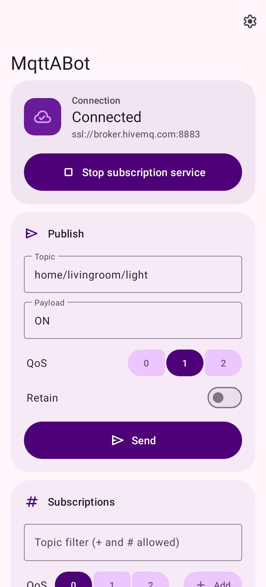
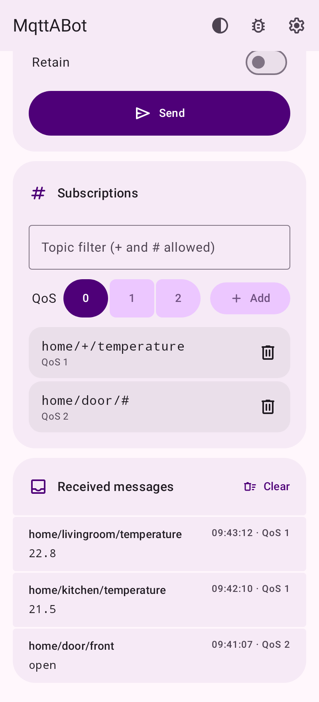
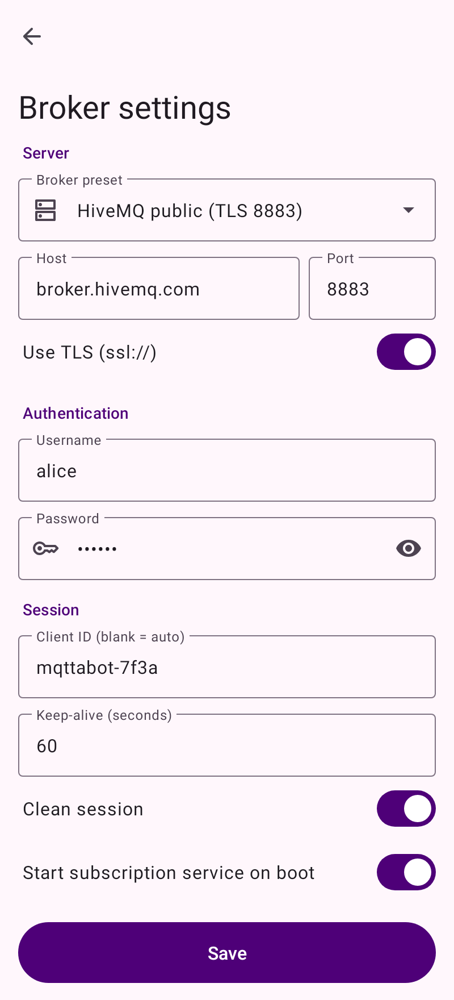
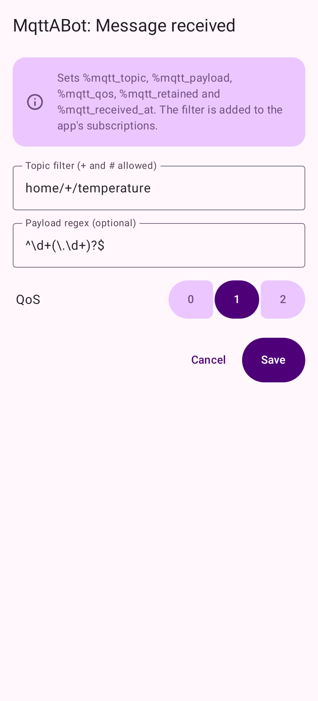
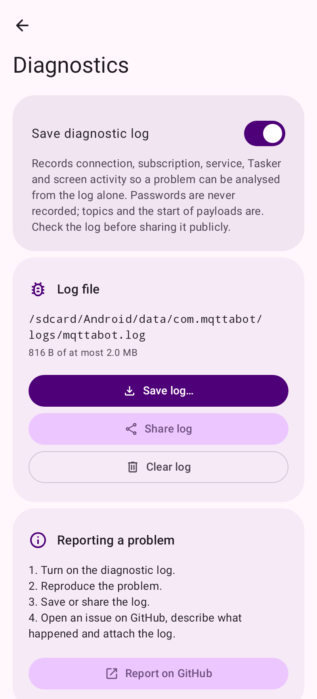

<div align="center">


# MqttABot

[](https://github.com/264768502/mqttabot/actions/workflows/ci.yml)
[](https://github.com/264768502/mqttabot/releases)
[](https://264768502.github.io/mqttabot/)
[](#build-and-test)
[](LICENSE)
[](https://developer.android.com/about/versions/nougat)
[](https://developer.android.com/about/versions/16)
[](https://kotlinlang.org)
[](https://tasker.joaoapps.com/)
[](https://github.com/264768502/mqttabot/commits/main)

</div>

**English** | [简体中文](README.zh-CN.md)

Android MQTT client + persistent subscription service + Tasker plugin. Written entirely in Kotlin, with no C/C++/JNI code.

- Minimum Android 7.0 (API 24), target Android 16 (API 36), compiled against SDK 37
- MQTT library: Eclipse Paho `mqttv3` (pure Java)
- UI: Jetpack Compose with Material 3 Expressive (`material3` 1.5)
- Build: Gradle 9.8 + AGP 9.5 (built-in Kotlin)

## Install

- **F-Droid (recommended):** we publish our own F-Droid repository, so the F-Droid app installs MqttABot and keeps it updated.
  - **Scan:** in F-Droid open **Settings → Repositories → +** and scan this QR code (it includes the fingerprint):

    

  - On your phone, open **[https://264768502.github.io/mqttabot/](https://264768502.github.io/mqttabot/)** and tap **Add to F-Droid**, or
  - in F-Droid open **Settings → Repositories → +** and enter `https://264768502.github.io/mqttabot/repo`.
  - Check that the fingerprint is `7BDA3AF80BBE18911290B0443571D2D32FF17CFB22B6D607C25E5920A41BDF5F`.
- **GitHub Releases:** download `mqttabot-<version>-release.apk` from [Releases](https://github.com/264768502/mqttabot/releases) and install it.

Both channels ship the same APK signed with the same key, so you can switch between them without uninstalling.

## Screenshots

| Main screen | Messages | Broker settings | Tasker event | Diagnostics |
| :---: | :---: | :---: | :---: | :---: |
|  |  |  |  |  |

Dark theme:

| | | | | |
| :---: | :---: | :---: | :---: | :---: |
|  |  |  |  |  |

## Features

| Feature | Description |
| --- | --- |
| Publish | Enter topic / payload / QoS / retain on the main screen and send. Reuses the subscription service's long-lived connection when it is running, otherwise opens a one-shot connection. |
| Subscription service | `MqttService` foreground service (`specialUse` type) with an ongoing notification showing the connection state and a "Stop" action; reconnects and resubscribes automatically; optional start on boot; optional notification for each received message (off by default, latest message per topic). |
| Built-in brokers | test.mosquitto.org (TCP / TLS / authenticated 1884), broker.hivemq.com, broker.emqx.io, mqtt.eclipseprojects.io (TCP and TLS), or a custom broker; supports username, password, client ID, keep-alive and clean session. |
| Tasker action | "MqttABot: Publish" — publish MQTT messages from Tasker; topic and payload accept Tasker `%variables`. |
| Tasker event | "MqttABot: Message received" — received messages trigger Tasker profiles, with topic wildcards (`+`, `#`) and an optional payload regex. Saving the event adds its filter to the subscription list. |
| Interface | Jetpack Compose, Material 3 Expressive: wallpaper-based dynamic color on Android 12+ (brand purple otherwise), edge-to-edge layout, collapsing top app bar, connected button groups for QoS, and a centred column on tablets and in landscape. |
| Theme | Automatic (light 07:00–19:00, dark otherwise; switches live), or always light / always dark. Chosen from the top bar. |
| Background activity | The main screen shows the app's battery usage setting (Unrestricted / Optimized / Restricted) and opens the right system screen to allow unrestricted background activity, so the subscription keeps running with the screen off. |
| Permissions | Asked for only when needed: notifications (Android 13+) when the service starts. If declined, the app explains why it needs it and links to the system setting. |
| Diagnostic log | Optional (Diagnostics screen, bug icon). Records connection, subscription, service, Tasker and UI activity plus crashes, so a problem can be analysed from the log alone; never records passwords, and keeps payloads to a short excerpt. Bounded to 2 MB (4 rotating files). Stored in app-specific storage (`Android/data/com.mqttabot/files/logs/`); the screen shows the path and can save the log (system file picker), share it, or open a GitHub issue to attach it to. |
| Languages | English, Simplified Chinese, Traditional Chinese, Spanish, German, Korean and Japanese. By default the app follows the system language and falls back to English; a language can be forced from the top bar (on Android 13+ also per app in system settings). |

### Using with Tasker

1. **Publish**: Task → Add Action → Plugin → MqttABot: Publish, then enter a topic (e.g. `home/%room/light`) and payload (e.g. `%state`).
2. **Trigger**: Profile → Event → Plugin → MqttABot: Message received, then enter a topic filter (e.g. `sensors/+/temperature`).
   Make sure the subscription service is running in the app. Variables available when the event fires:

   | Variable | Meaning |
   | --- | --- |
   | `%mqtt_topic` | Message topic |
   | `%mqtt_payload` | Payload (UTF-8) |
   | `%mqtt_qos` | QoS (0–2) |
   | `%mqtt_retained` | Whether it is a retained message (true/false) |
   | `%mqtt_received_at` | Receive time (epoch milliseconds) |

The plugin implements the standard Locale/Tasker plugin protocol (`EDIT_SETTING`/`FIRE_SETTING`, `ACTION_EDIT_EVENT`/`REQUEST_QUERY`/`QUERY_CONDITION`); see `app/src/main/kotlin/com/mqttabot/tasker/`.

## Build and test

Requires JDK 17+ and the Android SDK (`platforms;android-37.0`, `build-tools;37.0.0`); set `sdk.dir` in `local.properties`.

```bash
./gradlew assembleDebug                         # build the APK
./gradlew check                                 # lint (warnings fail) + all tests + 100% coverage gate
./gradlew testDebugUnitTest                     # all JVM tests (unit + end-to-end)
./gradlew jacocoUnitTestCoverageVerification -PskipE2e   # verify 100% coverage with unit tests only
./gradlew testDebugUnitTest --tests 'com.mqttabot.e2e.*'  # end-to-end tests only
./gradlew testDebugUnitTest -Pscreenshots               # re-render screenshots + icon (fastlane/, docs/screenshots/dark/)
```

Coverage report: `app/build/reports/jacoco/jacocoUnitTestReport/html/index.html`. The gate requires 100% instruction, branch, line, method and class coverage (only generated `R`/`BuildConfig` are excluded).

### About the tests

- Unit tests use JUnit4 + Robolectric (API 36 by default; `MinSdkCompatTest` runs the main flows on API 24) + MockK; screens are driven with the Compose UI test APIs (`createEmptyComposeRule` + `ActivityScenario`).
- End-to-end tests (`app/src/test/kotlin/com/mqttabot/e2e/`) start a real MQTT broker in-process (Moquette, with its native dependencies excluded so it runs on pure Java/NIO). The app uses the real Paho client over real sockets, and `FakeTasker` drives the plugin using Tasker's protocol:
  - `PublishEndToEndTest`: configure the action in the Tasker edit screen → variable substitution → `FIRE_SETTING` → broker → an independent subscriber receives the message; also publishing from the main screen over the service's long-lived connection.
  - `SubscribeEndToEndTest`: configure the event in the Tasker edit screen → start the foreground service → another client publishes → `REQUEST_QUERY` → `QUERY_CONDITION` returns "satisfied" with variables; also verifies automatic reconnect and resubscribe after the broker drops the connection.
- There are no `androidTest` instrumentation tests yet; the end-to-end tests run on the JVM under Robolectric, without an emulator.

## Development

- **Formatting**: Spotless + ktlint (`ktlint_official`, rules in `.editorconfig`). `./gradlew spotlessApply` fixes, `./gradlew spotlessCheck` verifies.
- **pre-commit**: `pip install pre-commit && pre-commit install`. Hooks run formatting, Android lint, unit tests with the 100% coverage gate, the dependency audit and basic file checks; `pre-commit run --all-files` runs them all.
- **Dependency locking**: all resolved versions are pinned in `gradle.lockfile`s. After changing dependencies run `./gradlew buildEnvironment :app:dependencies --write-locks`.
- **Dependency audit**: [OSV-Scanner](https://google.github.io/osv-scanner/) checks the lockfiles against osv.dev: `osv-scanner scan source --recursive --config=osv-scanner.toml .`. Patched versions of vulnerable transitive build/test dependencies are pinned in `settings.gradle.kts`; audited exceptions live in `osv-scanner.toml`.
- **CI**: GitHub Actions (`.github/workflows/ci.yml`) runs format, lint, tests + coverage, and the dependency audit on every push to `main` and on pull requests.

## Releasing

`.github/workflows/release.yml` builds and publishes a GitHub Release with `mqttabot-<version>-release.apk`, `mqttabot-<version>-debug.apk` and `SHA256SUMS.txt`. Before building it runs the format check, lint, all tests and the coverage gate. Two ways to start it:

- **Recommended:** run the **Release** workflow manually (Actions → Release → Run workflow) with a version such as `1.2.0`. It updates `versionName`/`versionCode` in `app/build.gradle.kts`, commits that to `main`, creates the tag and publishes.
- Or bump `versionName`/`versionCode` in `app/build.gradle.kts` yourself, commit, then push a tag: `git tag v1.2.0 && git push origin v1.2.0`. The workflow fails if the tag doesn't match the source.

The version lives in the source (F-Droid reads it from there): `versionName` is the tag without the `v`, and `versionCode` = `major × 1,000,000 + minor × 1,000 + patch`. Versions with a suffix (e.g. `1.3.0-beta.1`) are published as pre-releases. Optionally add release notes for the stores in `fastlane/metadata/android/<locale>/changelogs/<versionCode>.txt`.

**Signing.** Add these repository secrets (Settings → Secrets and variables → Actions) to sign release APKs with your own key:

| Secret | Value |
| --- | --- |
| `SIGNING_KEYSTORE_BASE64` | The keystore file, base64-encoded (`base64 -w0 release.jks`) |
| `SIGNING_KEYSTORE_PASSWORD` | Keystore password |
| `SIGNING_KEY_ALIAS` | Key alias |
| `SIGNING_KEY_PASSWORD` | Key password (same as the keystore password for PKCS12 keystores) |

Every successful release also updates the [F-Droid repository](#f-droid-repository) automatically.

Without them, final releases are refused. Pre-releases are signed with the runner's throwaway debug key, and the release notes say so; such APKs install, but each one has a different signature, so users can't upgrade between them without uninstalling.

## F-Droid repository

The F-Droid repository at `https://264768502.github.io/mqttabot/repo` is built and published by [`.github/workflows/fdroid-repo.yml`](.github/workflows/fdroid-repo.yml) after every successful Release (or manually via Actions → F-Droid repo → Run workflow):

1. [`fdroid/repo/build-repo.sh`](fdroid/repo/build-repo.sh) downloads the signed `*-release.apk` of every published (non-pre-release) GitHub release.
2. `fdroid update` (fdroidserver) builds the index from [`fdroid/repo/metadata/com.mqttabot.yml`](fdroid/repo/metadata/com.mqttabot.yml) plus the store texts, icon and screenshots in `fastlane/metadata/android/`, and signs it with the repository key.
3. Only the generated site (`repo/` + a landing page from [`fdroid/repo/index.html`](fdroid/repo/index.html)) is deployed to GitHub Pages; the key and config never are.

The repository key is separate from the APK signing key. It is stored in the `FDROID_KEYSTORE_BASE64` and `FDROID_KEYSTORE_PASSWORD` secrets (PKCS12, alias `mqttabot-repo`); its SHA-256 fingerprint is `7BDA3AF80BBE18911290B0443571D2D32FF17CFB22B6D607C25E5920A41BDF5F`. Back it up: if it changes, every user has to remove and re-add the repository.

[`fdroid/repo/qr.png`](fdroid/repo/qr.png) encodes `https://264768502.github.io/mqttabot/repo?fingerprint=7BDA3AF80BBE18911290B0443571D2D32FF17CFB22B6D607C25E5920A41BDF5F`. If the address or key changes, regenerate it with `pip install segno` and `segno --scale 8 --border 4 -o fdroid/repo/qr.png "<repo-url>?fingerprint=<fingerprint>"`.

To test locally: `FDROID_KEYSTORE=… FDROID_KEYSTORE_PASSWORD=… GH_TOKEN=… fdroid/repo/build-repo.sh /tmp/fdroid-work /tmp/fdroid-site`.

### Official F-Droid (paused)

We submitted to the official F-Droid repository ([fdroiddata!55280](https://gitlab.com/fdroid/fdroiddata/-/merge_requests/55280)); it was closed because F-Droid only includes apps that have been maintained for more than 3 months. We plan to resubmit after February 2027. Everything is prepared: [`fdroid/com.mqttabot.yml`](fdroid/com.mqttabot.yml) is in fdroiddata format, builds are reproducible (F-Droid's build matches the signed GitHub release, verified with `fdroid build`), and F-Droid's CI checks passed except the policy review. When resubmitting, update the file to the latest tag (full commit hash, versions) and keep:

- no Maven repositories other than Google, Maven Central and the Gradle plugin portal, and no non-free dependencies (F-Droid's scanner rejects them);
- `dependenciesInfo { includeInApk = false }` in `app/build.gradle.kts` (F-Droid rejects the encrypted dependency block);
- literal `versionCode` / `versionName` (F-Droid reads them), and the same toolchain (JDK 21) in the release workflow and F-Droid's build, so builds stay reproducible.

## Notes

- Passwords are stored in the app's private SharedPreferences and are excluded from backup and device transfer.
- On Android 13+, starting the service the first time asks for notification permission; if denied, the service still runs, but its notification is hidden.

## License

[MIT](LICENSE)
