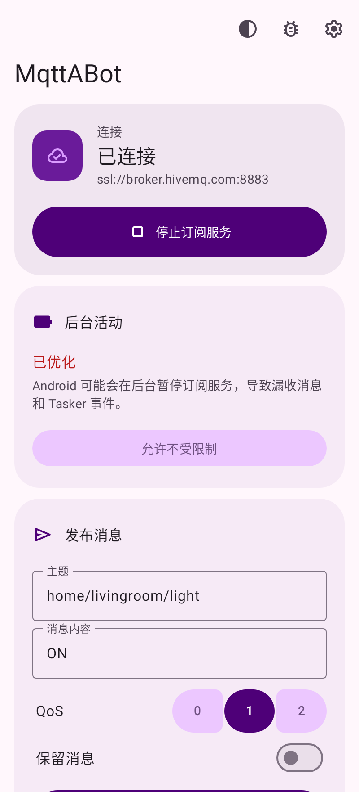
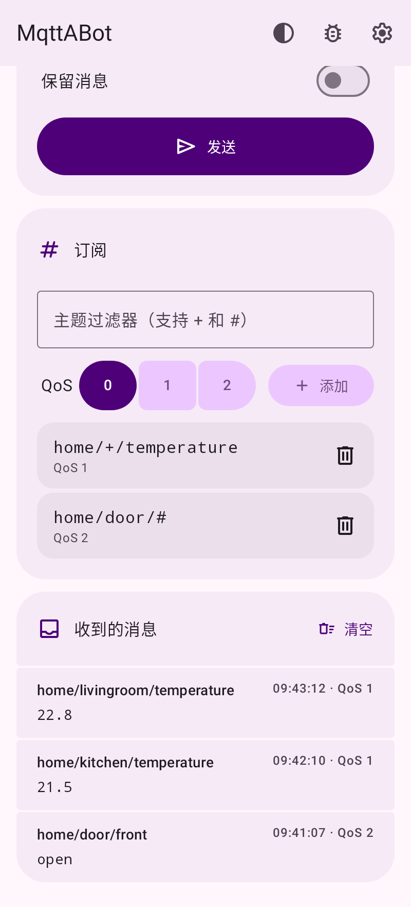
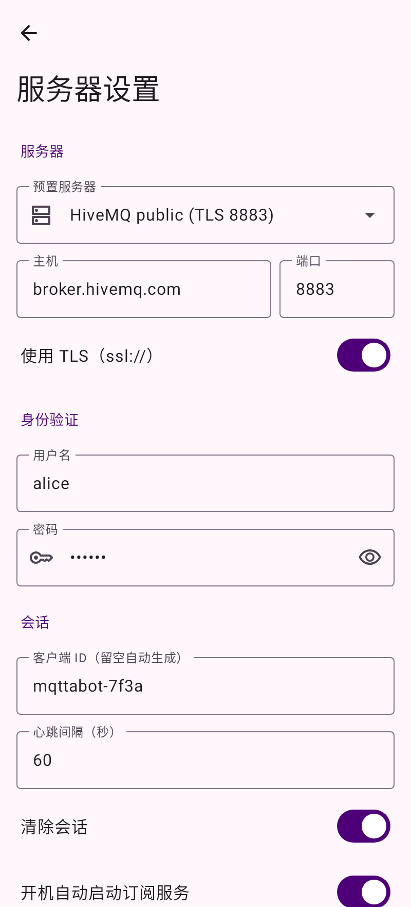
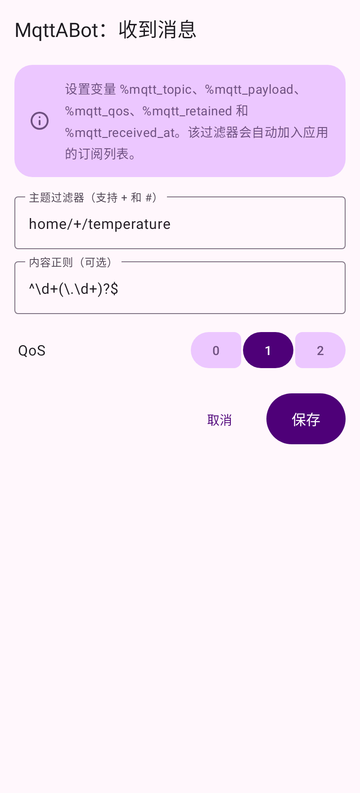
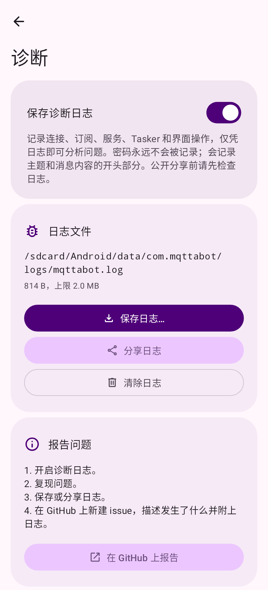
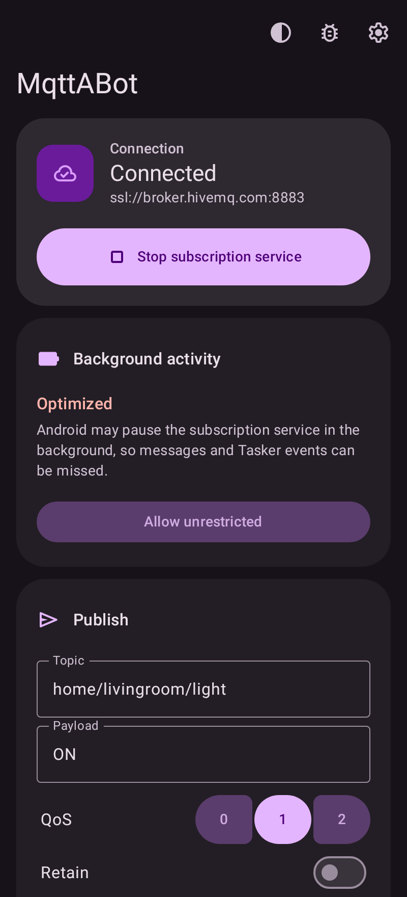
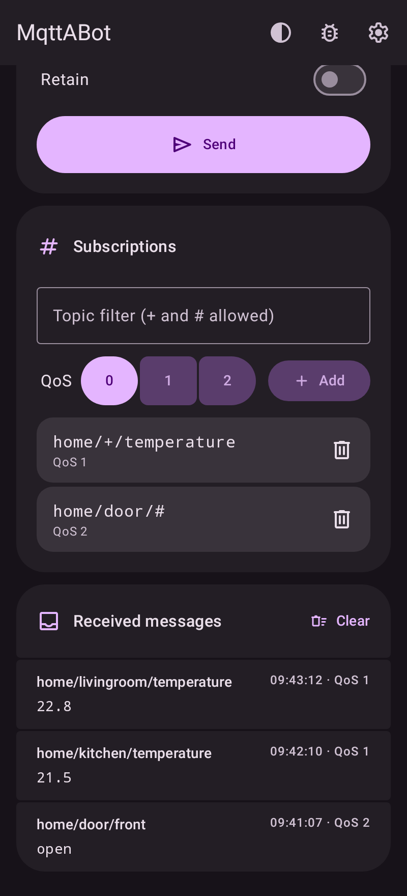
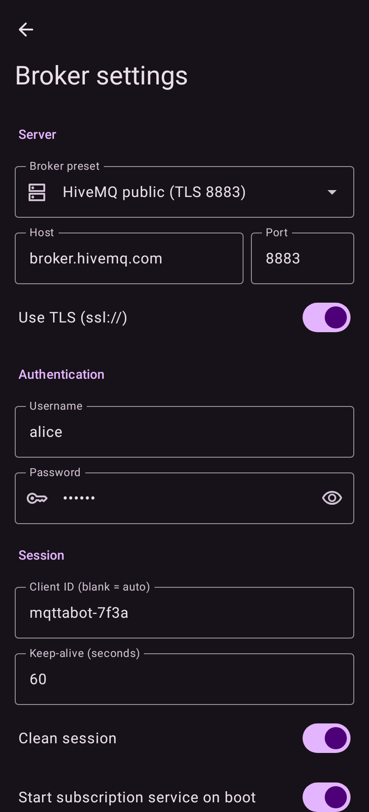
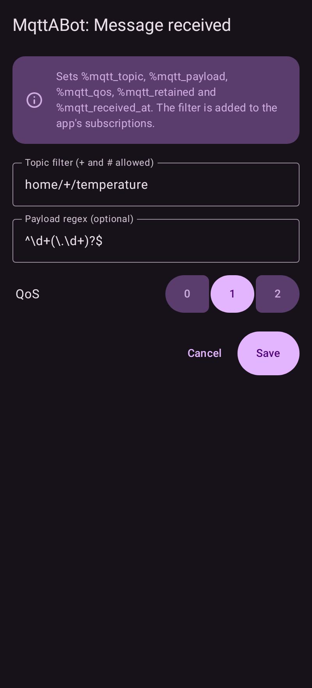
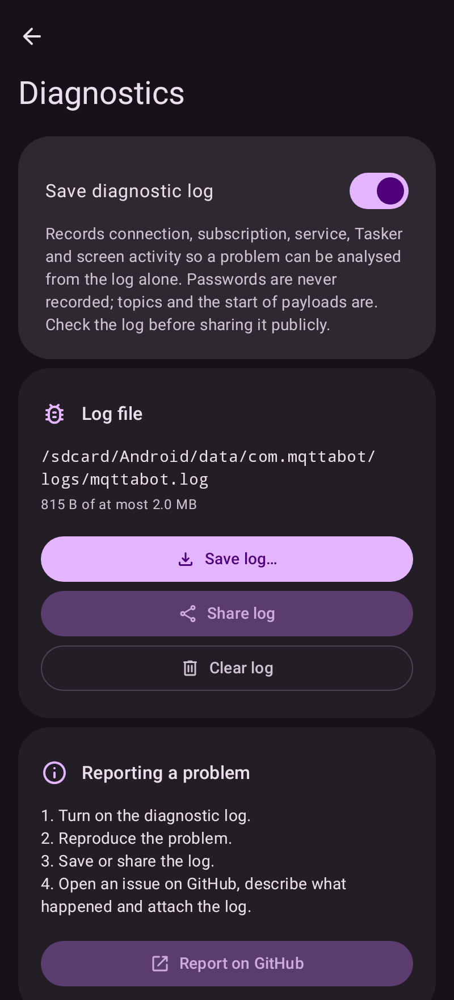

<div align="center">


# MqttABot

[](https://github.com/264768502/mqttabot/actions/workflows/ci.yml)
[](https://github.com/264768502/mqttabot/releases)
[](https://264768502.github.io/mqttabot/)
[](#构建与测试)
[](LICENSE)
[](https://developer.android.com/about/versions/nougat)
[](https://developer.android.com/about/versions/16)
[](https://kotlinlang.org)
[](https://tasker.joaoapps.com/)
[](https://github.com/264768502/mqttabot/commits/main)

</div>

[English](README.md) | **简体中文**

Android MQTT 客户端 + 常驻订阅服务 + Tasker 插件。纯 Kotlin 实现，无 C/C++/JNI 代码。

- 最低支持 Android 7.0（API 24），目标版本 Android 16（API 36），编译 SDK 37
- MQTT 库：Eclipse Paho `mqttv3`（纯 Java）
- 界面：Jetpack Compose + Material 3 Expressive（`material3` 1.5）
- 构建：Gradle 9.8 + AGP 9.5（内置 Kotlin）

## 安装

- **F-Droid（推荐）：** 我们维护了自己的 F-Droid 存储库，F-Droid 应用可以直接安装 MqttABot 并自动更新。
  - **扫码：** 在 F-Droid 中打开 **设置 → 存储库 → +**，扫描下面的二维码（已包含指纹）：

    

  - 在手机上打开 **[https://264768502.github.io/mqttabot/](https://264768502.github.io/mqttabot/)**，点 **Add to F-Droid**；或者
  - 在 F-Droid 中打开 **设置 → 存储库 → +**，填入 `https://264768502.github.io/mqttabot/repo`。
  - 核对指纹为 `7BDA3AF80BBE18911290B0443571D2D32FF17CFB22B6D607C25E5920A41BDF5F`。
- **GitHub Releases：** 从 [Releases](https://github.com/264768502/mqttabot/releases) 下载 `mqttabot-<版本>-release.apk` 并安装。

两个渠道发布的是同一个 APK、同一个签名，可以随意切换而无需卸载。

## 截图

| 主界面 | 消息 | 服务器设置 | Tasker 事件 | 诊断 |
| :---: | :---: | :---: | :---: | :---: |
|  |  |  |  |  |

深色主题：

| | | | | |
| :---: | :---: | :---: | :---: | :---: |
|  |  |  |  |  |

## 功能

| 功能 | 说明 |
| --- | --- |
| 发送消息 | 主界面填写 topic / payload / QoS / retain 后发送。订阅服务运行时复用其长连接，否则建立一次性连接。 |
| 订阅服务 | `MqttService` 前台服务（`specialUse` 类型），常驻通知显示连接状态并提供“停止”按钮；断线自动重连并重新订阅；可设置开机自启。 |
| 内置服务器 | test.mosquitto.org（TCP / TLS / 带认证 1884）、broker.hivemq.com、broker.emqx.io、mqtt.eclipseprojects.io（TCP 与 TLS），也可自定义；支持用户名、密码、Client ID、Keep-alive、Clean session。 |
| Tasker 动作 | “MqttABot: Publish”——在 Tasker 中发送 MQTT 消息，topic 与 payload 支持 Tasker `%变量`。 |
| Tasker 事件 | “MqttABot: Message received”——订阅到的消息作为 Tasker 触发器，支持 topic 通配符（`+`、`#`）和可选的 payload 正则。保存时自动把过滤器加入订阅列表。 |
| 界面 | Jetpack Compose，Material 3 Expressive 设计：Android 12+ 跟随壁纸动态取色（其他版本使用品牌紫色），全面屏（edge-to-edge）布局、可折叠顶部栏、QoS 连接按钮组；平板和横屏时内容居中显示。 |
| 主题 | 自动（07:00–19:00 浅色，其余时间深色，到点实时切换），或始终浅色 / 始终深色；在顶部栏选择。 |
| 后台活动 | 主界面显示本应用的电池用量设置（不受限制 / 已优化 / 受限），并直达对应的系统界面以允许不受限制的后台活动，保证熄屏时订阅不中断。 |
| 权限 | 仅在需要时申请：启动服务时申请通知权限（Android 13+）。用户拒绝后，应用会说明为什么需要该权限，并提供跳转到系统设置的入口。 |
| 诊断日志 | 可选（诊断界面，虫子图标）。记录连接、订阅、服务、Tasker 和界面操作以及崩溃信息，仅凭日志即可分析问题；从不记录密码，消息内容只保留开头一小段。总大小上限 2 MB（4 个轮转文件）。保存在应用专属存储（`Android/data/com.mqttabot/files/logs/`）；界面会显示日志路径，并可通过系统文件选择器保存日志、分享日志，或打开 GitHub issue 以附上日志。 |
| 多语言 | 英文、简体中文、繁体中文、西班牙文、德文、韩文和日文。自动跟随系统语言，不支持的语言显示英文；Android 13+ 还可以在系统设置中单独为本应用选择语言。 |

### Tasker 使用

1. **发送**：任务 → 添加动作 → 插件 → MqttABot: Publish，填写 topic（如 `home/%room/light`）与 payload（如 `%state`）。
2. **触发**：配置文件 → 事件 → 插件 → MqttABot: Message received，填写过滤器（如 `sensors/+/temperature`）。
   确保 App 中已启动订阅服务。事件触发时可用变量：

   | 变量 | 含义 |
   | --- | --- |
   | `%mqtt_topic` | 消息主题 |
   | `%mqtt_payload` | 消息内容（UTF-8） |
   | `%mqtt_qos` | QoS（0–2） |
   | `%mqtt_retained` | 是否保留消息（true/false） |
   | `%mqtt_received_at` | 接收时间（毫秒时间戳） |

插件实现的是标准 Locale/Tasker 插件协议（`EDIT_SETTING`/`FIRE_SETTING`、`ACTION_EDIT_EVENT`/`REQUEST_QUERY`/`QUERY_CONDITION`），见 `app/src/main/kotlin/com/mqttabot/tasker/`。

## 构建与测试

需要 JDK 17+ 与 Android SDK（`platforms;android-37.0`、`build-tools;37.0.0`），在 `local.properties` 中设置 `sdk.dir`。

```bash
./gradlew assembleDebug                         # 构建 APK
./gradlew check                                 # lint（警告即失败）+ 全部测试 + 100% 覆盖率门禁
./gradlew testDebugUnitTest                     # 全部 JVM 测试（单元 + 端到端）
./gradlew jacocoUnitTestCoverageVerification -PskipE2e   # 只用单元测试验证 100% 覆盖率
./gradlew testDebugUnitTest --tests 'com.mqttabot.e2e.*'  # 只运行端到端测试
./gradlew testDebugUnitTest -Pscreenshots               # 重新生成 fastlane/ 和 docs/screenshots/dark/ 中的截图和图标
```

覆盖率报告：`app/build/reports/jacoco/jacocoUnitTestReport/html/index.html`。门禁要求指令、分支、行、方法、类覆盖率均为 100%（仅排除生成的 `R`/`BuildConfig`）。

### 测试说明

- 单元测试使用 JUnit4 + Robolectric（默认 API 36，`MinSdkCompatTest` 在 API 24 上运行主要流程）+ MockK；界面通过 Compose UI 测试 API（`createEmptyComposeRule` + `ActivityScenario`）驱动。
- 端到端测试（`app/src/test/kotlin/com/mqttabot/e2e/`）在进程内启动真实 MQTT broker（Moquette，已排除其原生依赖，纯 Java/NIO），App 内使用真实的 Paho 客户端与网络连接，`FakeTasker` 按 Tasker 的协议驱动插件：
  - `PublishEndToEndTest`：通过 Tasker 编辑界面配置动作 → 变量替换 → `FIRE_SETTING` → broker → 独立订阅者收到消息；以及主界面经订阅服务长连接发送。
  - `SubscribeEndToEndTest`：通过 Tasker 编辑界面配置事件 → 启动前台服务 → 其他客户端发布消息 → `REQUEST_QUERY` → `QUERY_CONDITION` 返回满足条件及变量；验证 broker 断线后自动重连、重新订阅。
- 暂无 `androidTest` 仪器测试；端到端测试在 JVM 上通过 Robolectric 运行，无需模拟器。

## 开发

- **格式化**：Spotless + ktlint（`ktlint_official`，规则见 `.editorconfig`）。`./gradlew spotlessApply` 自动修复，`./gradlew spotlessCheck` 检查。
- **pre-commit**：`pip install pre-commit && pre-commit install`。钩子会运行格式化、Android lint、单元测试与 100% 覆盖率门禁、依赖审计以及基础文件检查；`pre-commit run --all-files` 运行全部钩子。
- **依赖锁定**：所有解析出的版本固定在 `gradle.lockfile` 中。修改依赖后运行 `./gradlew buildEnvironment :app:dependencies --write-locks`。
- **依赖审计**：[OSV-Scanner](https://google.github.io/osv-scanner/) 根据 osv.dev 检查锁文件：`osv-scanner scan source --recursive --config=osv-scanner.toml .`。存在漏洞的构建/测试传递依赖的修复版本固定在 `settings.gradle.kts` 中；经审核的例外记录在 `osv-scanner.toml`。
- **CI**：GitHub Actions（`.github/workflows/ci.yml`）在每次推送到 `main` 及每个 Pull Request 时运行格式检查、lint、测试与覆盖率、依赖审计。

## 版本发布

`.github/workflows/release.yml` 会构建并发布 GitHub Release，附带 `mqttabot-<版本>-release.apk`、`mqttabot-<版本>-debug.apk` 和 `SHA256SUMS.txt`。构建前会运行格式检查、lint、全部测试和覆盖率门禁。两种触发方式：

- **推荐：** 手动运行 **Release** workflow（Actions → Release → Run workflow），填写版本号如 `1.2.0`。workflow 会更新 `app/build.gradle.kts` 中的 `versionName`/`versionCode`，提交到 `main`，创建 tag 并发布。
- 或者自己修改 `app/build.gradle.kts` 中的 `versionName`/`versionCode` 并提交，再推送 tag：`git tag v1.2.0 && git push origin v1.2.0`。tag 与源码中的版本不一致时 workflow 会失败。

版本号保存在源码中（F-Droid 从源码读取）：`versionName` 为去掉 `v` 的 tag，`versionCode` = `主版本 × 1,000,000 + 次版本 × 1,000 + 修订号`。带后缀的版本（如 `1.3.0-beta.1`）会发布为预发布版本。可选：在 `fastlane/metadata/android/<语言>/changelogs/<versionCode>.txt` 中为应用商店添加更新说明。

**签名。** 在仓库 Secrets（Settings → Secrets and variables → Actions）中添加以下内容，即可用自己的密钥签名 release APK：

| Secret | 值 |
| --- | --- |
| `SIGNING_KEYSTORE_BASE64` | base64 编码的 keystore 文件（`base64 -w0 release.jks`） |
| `SIGNING_KEYSTORE_PASSWORD` | keystore 密码 |
| `SIGNING_KEY_ALIAS` | 密钥别名 |
| `SIGNING_KEY_PASSWORD` | 密钥密码（PKCS12 keystore 与 keystore 密码相同） |

每次发布成功后，[F-Droid 存储库](#f-droid-存储库)也会自动更新。

未配置时，正式版本会被拒绝发布。预发布版本使用 CI 机器临时生成的 debug 密钥签名，release 说明中会注明；这样的 APK 可以安装，但每次签名都不同，用户在它们之间升级前需要先卸载。

## F-Droid 存储库

位于 `https://264768502.github.io/mqttabot/repo` 的 F-Droid 存储库由 [`.github/workflows/fdroid-repo.yml`](.github/workflows/fdroid-repo.yml) 在每次发布成功后自动构建并发布（也可在 Actions → F-Droid repo → Run workflow 手动运行）：

1. [`fdroid/repo/build-repo.sh`](fdroid/repo/build-repo.sh) 下载所有正式（非预发布）GitHub release 中已签名的 `*-release.apk`。
2. `fdroid update`（fdroidserver）根据 [`fdroid/repo/metadata/com.mqttabot.yml`](fdroid/repo/metadata/com.mqttabot.yml) 以及 `fastlane/metadata/android/` 中的商店文字、图标和截图生成索引，并用存储库密钥签名。
3. 只有生成的站点（`repo/` 和由 [`fdroid/repo/index.html`](fdroid/repo/index.html) 生成的说明页）会部署到 GitHub Pages，密钥和配置文件绝不会被发布。

存储库密钥与 APK 签名密钥相互独立，保存在 `FDROID_KEYSTORE_BASE64` 和 `FDROID_KEYSTORE_PASSWORD` 两个 secret 中（PKCS12，别名 `mqttabot-repo`），SHA-256 指纹为 `7BDA3AF80BBE18911290B0443571D2D32FF17CFB22B6D607C25E5920A41BDF5F`。请备份好它：一旦更换，所有用户都需要删除并重新添加存储库。

[`fdroid/repo/qr.png`](fdroid/repo/qr.png) 编码的内容是 `https://264768502.github.io/mqttabot/repo?fingerprint=7BDA3AF80BBE18911290B0443571D2D32FF17CFB22B6D607C25E5920A41BDF5F`。地址或密钥变化时，用 `pip install segno` 和 `segno --scale 8 --border 4 -o fdroid/repo/qr.png "<存储库地址>?fingerprint=<指纹>"` 重新生成。

本地测试：`FDROID_KEYSTORE=… FDROID_KEYSTORE_PASSWORD=… GH_TOKEN=… fdroid/repo/build-repo.sh /tmp/fdroid-work /tmp/fdroid-site`。

### 官方 F-Droid（已暂停）

我们曾向官方 F-Droid 仓库提交（[fdroiddata!55280](https://gitlab.com/fdroid/fdroiddata/-/merge_requests/55280)），但因 F-Droid 只收录维护超过 3 个月的应用而被关闭。计划在 2027 年 2 月之后重新提交。所需内容均已准备好：[`fdroid/com.mqttabot.yml`](fdroid/com.mqttabot.yml) 为 fdroiddata 格式，构建可复现（已用 `fdroid build` 验证 F-Droid 的构建与已签名的 GitHub release 一致），除政策审核外 F-Droid 的 CI 检查均已通过。重新提交时，把该文件更新到最新 tag（完整 commit hash、版本号），并保持：

- 不使用 Google、Maven Central 和 Gradle 插件门户以外的 Maven 仓库，不引入非自由依赖（F-Droid 的扫描器会拒绝）；
- `app/build.gradle.kts` 中保留 `dependenciesInfo { includeInApk = false }`（F-Droid 会拒绝加密的依赖信息块）；
- `versionCode` / `versionName` 保持字面值（F-Droid 会读取），发布 workflow 与 F-Droid 构建使用相同的工具链（JDK 21），以保证构建可复现。

## 说明

- 密码保存在应用私有 SharedPreferences 中，并已排除在备份/设备迁移之外。
- Android 13+ 首次启动服务时会请求通知权限；拒绝后服务照常运行，只是通知不可见。

## 许可证

[MIT](LICENSE)
